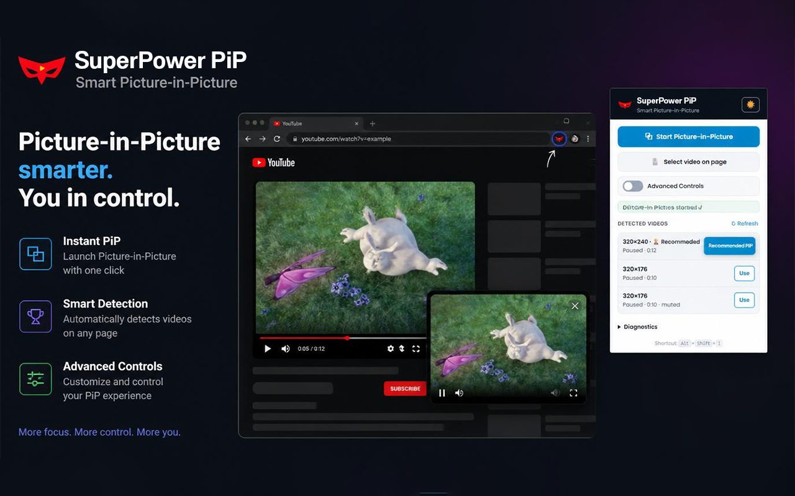

# ⚡ Superpower PiP

**Smart Picture-in-Picture for Chrome.** Detects the right video on any page, breaks the scripts that block PiP, and gives you full control in one click.

[](https://chromewebstore.google.com/detail/superpower-pip-smart-pict/bpnokiblogdcbcncibedkfhggbfndelo)
[](LICENSE)
[](manifest.json)
[](manifest.json)



## ✨ Features

- **Smart detection** — scores every `<video>` across all frames (size, visibility, audio, playback) and picks the best one.
- **One-click PiP** — toolbar button, `Alt+Shift+I`, or right-click menu.
- **Advanced PiP window** — custom player with play/pause, seek, volume and playback speed (Chrome 116+), with native fallback.
- **Auto PiP on tab switch** — keeps the video floating when you leave the page, and closes it when you come back.
- **Multi-PiP** — pop every playing video into its own independent window.
- **Remembers size & position** — your advanced PiP window reopens exactly where you left it.
- **Volume control & "Exit all"** — manage every PiP window from the popup.
- **Diagnostics panel** — see why a site blocks PiP, per frame, with no guesswork.

## 🚀 Install

### Chrome Web Store (recommended)

→ **[Superpower PiP on the Chrome Web Store](https://chromewebstore.google.com/detail/superpower-pip-smart-pict/bpnokiblogdcbcncibedkfhggbfndelo)**

### From source

```bash
git clone https://github.com/SnegOwo/SuperPower-PiP.git
```

1. Open `chrome://extensions`
2. Enable **Developer mode**
3. Click **Load unpacked** and select the cloned folder
4. Pin the ⚡ icon to the toolbar

There is no build step and no dependency: plain JavaScript, HTML, CSS and JSON. Reload the extension from `chrome://extensions` after editing.

## 🕹️ Usage

| Action | Shortcut |
|---|---|
| Open the PiP panel | Click the ⚡ icon |
| Toggle PiP instantly | `Alt+Shift+I` |
| Toggle PiP from the page | Right-click → **Start Picture-in-Picture** |

The popup lists every detected video, highlights the best candidate, and exposes the settings (auto PiP, multi-PiP, window memory, volume, diagnostics).

## 🔒 Privacy & permissions

No analytics, no telemetry, no remote server, no `host_permissions`. `pip-core.js` is injected **only on user action** through `activeTab`, so no script runs in the background on the pages you visit.

| Permission | Why it is needed |
|---|---|
| `activeTab` | Temporary access to the active tab, only after you act |
| `scripting` | Inject `pip-core.js` on demand |
| `contextMenus` | Add the right-click entry |
| `storage` | Save local preferences (theme, advanced mode, window position) |
| `tabs` | Read the active tab's title/URL for the popup |

Full policy: [PRIVACY_POLICY.md](PRIVACY_POLICY.md).

## 🧩 Project structure

```
manifest.json           # MV3, minimal permissions
background.js           # service worker: shortcut + context menu
content/pip-core.js     # injected on demand: detection + requestPictureInPicture
shared/tab-actions.js    # shared orchestration (popup + background)
popup/                  # UI: main action, video list, settings, diagnostics
icons/                  # 16 / 48 / 128 px
index.html              # landing page (super-power-pi-p.vercel.app)
```

## ⚙️ Requirements

- Chrome / Chromium 116+ for the advanced Document PiP window (older versions fall back to native PiP).
- No Node.js, bundler or package manager required.

## ⚠️ Known limitations

- **DRM-protected players** (Netflix, some streaming services) block native PiP by design.
- Sites sending `Permissions-Policy: picture-in-picture=()` cannot be worked around.
- Restricted pages (`chrome://`, Chrome Web Store, some `file://`) are inaccessible to extensions.
- Canvas-only players have no real `<video>` element, so PiP is impossible.

## 🤝 Contributing

Issues and pull requests are welcome — see [CONTRIBUTING.md](CONTRIBUTING.md). Keep the code dependency-free and the permission set minimal.

## 📄 License

[MIT](LICENSE) © 2026 SnegOwo
